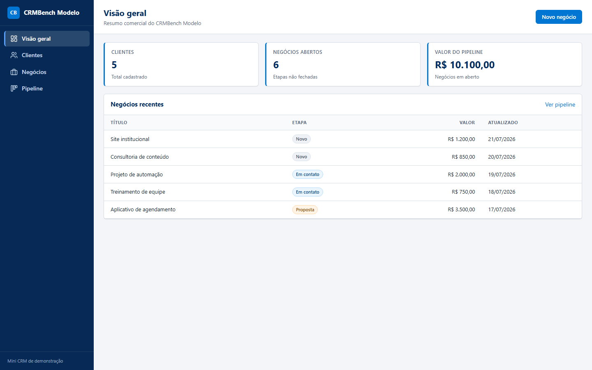
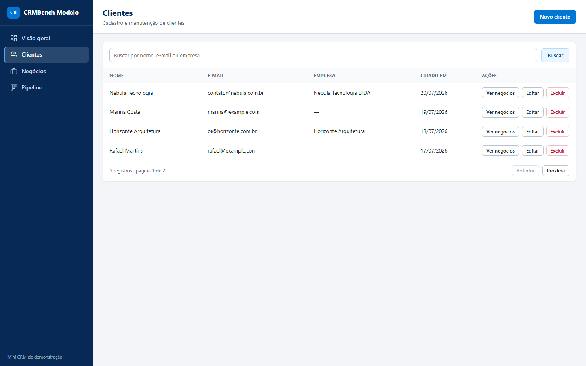
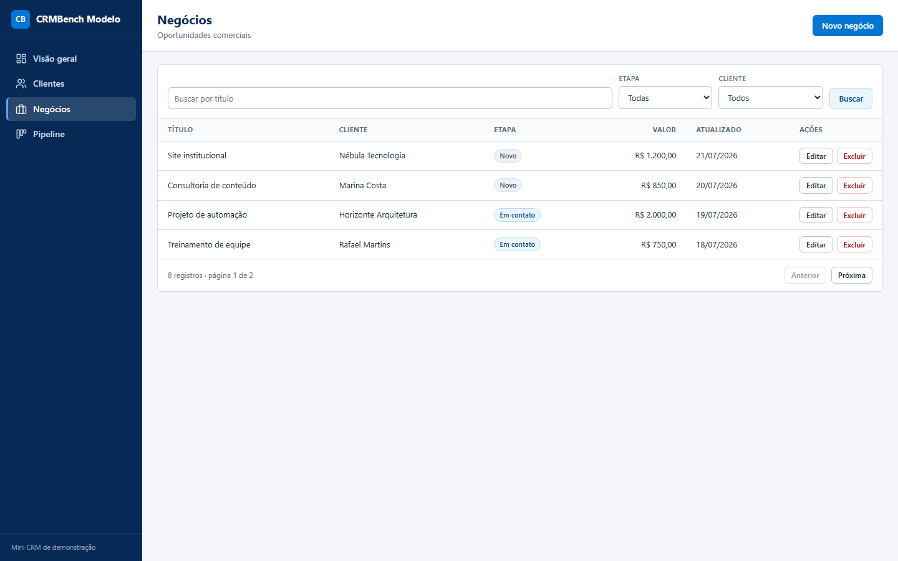
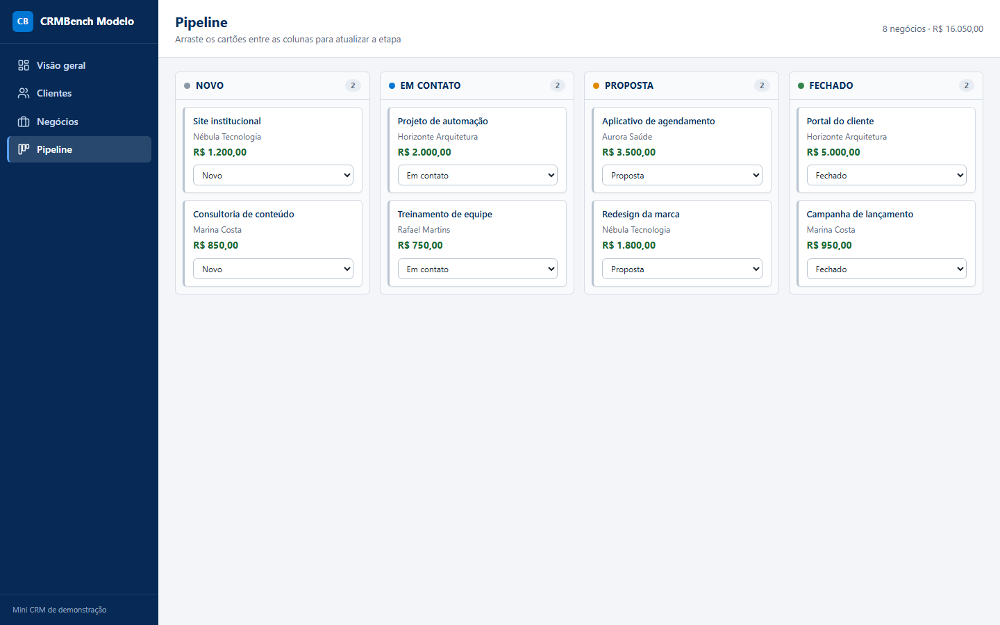

# Relatório da avaliação — deepseek-4-1-flash__openrouter__2026-09-10

**Nota:** 96/100

**Resultado:** 21 passaram, 1 falhou e 0 ficaram sem executar.

## Execução

| Campo | Valor |
|---|---:|
| Modelo | `deepseek/deepseek-v4.1-flash` |
| Provider | OpenRouter |
| Harness | OpenCode 1.18.30 |
| Raciocínio | `high` |
| Custo da criação | US$ 0,04 |
| Tempo oficial | 3m59s |
| Turnos | 28 |
| Chamadas de ferramentas | 48 |

A execução foi concluída de forma autônoma, com uma única mensagem do usuário e sem prompt de correção. O tempo oficial corresponde à sessão completa.

## Screenshots

### Dashboard

### Clientes

### Negócios

### Pipeline

## Resumo em linguagem simples

- **Instalação e banco:** as dependências foram instaladas normalmente e o banco foi recriado duas vezes com o seed correto.
- **Build e inicialização:** frontend e servidor compilaram e a aplicação serviu API e interface na mesma origem.
- **Clientes:** criação, listagem, busca, paginação, edição, exclusão e integridade dos relacionamentos funcionaram na API e na interface.
- **Negócios:** CRUD, busca, filtros, paginação, validações e relacionamento com clientes funcionaram.
- **Indicadores:** os valores acompanharam exatamente os dados persistidos.
- **Pipeline:** as quatro etapas e todos os cartões apareceram; as mudanças pelo seletor e por arrastar e soltar persistiram após reiniciar o servidor.
- **Interface:** os fluxos e a confirmação de exclusão funcionaram, mas o feedback de sucesso após a ação não permaneceu visível.
- **Qualidade:** o nome obrigatório foi usado, seis testes automatizados passaram e o README documentou os comandos exigidos.

## O que não funcionou

O check `ui.feedback` perdeu 4 pontos. O projeto define uma mensagem de sucesso ao concluir uma exclusão, mas em seguida recarrega a lista. Essa recarga executa `setFeedback(null)`, removendo a mensagem antes que ela permaneça observável na interface. A exclusão em si foi concluída e persistida corretamente; a falha está no retorno visual ao usuário.

## Auditoria contra falsos negativos

A primeira passagem marcou incorretamente as duas confirmações de exclusão porque o avaliador reconhecia `role="dialog"`, enquanto esta implementação válida usa `role="alertdialog"`. O avaliador foi generalizado para aceitar ambos os papéis, sem alterar o projeto participante. A aplicação de referência foi reavaliada após o ajuste e permaneceu em 100/100.

Na nova execução, os fluxos de clientes e negócios passaram. A falha de feedback foi então conferida no código e no comportamento: ela decorre da limpeza imediata do estado de sucesso pelo próprio participante, portanto não é falso negativo. A nota final permaneceu em 96/100.

## Resultado por verificação

| Verificação | Resultado | Pontos | Evidência |
|---|---:|---:|---|
| setup.install | PASS | 2/2 | `npm install` concluiu em 5291 ms com a stack obrigatória. |
| setup.database | PASS | 3/3 | `db:setup` recriou duas vezes o banco isolado indicado por `DB_PATH`. |
| setup.build | PASS | 4/4 | O build de produção concluiu em 3168 ms. |
| setup.start | PASS | 5/5 | `npm start` serviu a API e a interface na mesma origem. |
| clients.create | PASS | 5/5 | Cliente 6 foi criado com campos normalizados e timestamps válidos. |
| clients.read | PASS | 4/4 | Listagem, busca case-insensitive e páginas de clientes refletiram o banco. |
| clients.update | PASS | 4/4 | A edição parcial mudou o nome, preservou o e-mail e atualizou o timestamp. |
| clients.delete | PASS | 5/5 | Cliente sem vínculo foi excluído; cliente com negócio recebeu 409 sem cascata. |
| deals.create | PASS | 6/6 | Negócio 9 foi criado e ligado ao cliente 6. |
| deals.read | PASS | 4/4 | Listagem, busca, filtros combinados e paginação de negócios refletiram o banco. |
| deals.update | PASS | 5/5 | A edição parcial persistiu a etapa e preservou os demais campos. |
| deals.delete | PASS | 4/4 | O negócio solicitado foi excluído sem remover clientes ou outros dados. |
| deals.validation | PASS | 4/4 | Título, valor, etapa e relacionamento inválidos foram recusados sem gravação parcial. |
| metrics.accuracy | PASS | 8/8 | Os indicadores conferiram antes e depois de criar, fechar e excluir um negócio. |
| pipeline.render | PASS | 6/6 | As quatro etapas, na ordem correta, exibiram todos os negócios persistidos. |
| pipeline.persistence | PASS | 6/6 | A etapa mudou pela interface e permaneceu no SQLite após reiniciar o servidor. |
| pipeline.drag_drop | PASS | 5/5 | O cartão foi arrastado e permaneceu na nova coluna após reiniciar o servidor. |
| ui.client_flow | PASS | 5/5 | Paginação, busca, negócios relacionados e CRUD de clientes funcionaram pela interface. |
| ui.deal_flow | PASS | 5/5 | Paginação, busca, filtros combinados e CRUD de negócios funcionaram pela interface. |
| ui.feedback | FAIL | 0/4 | A mensagem de sucesso é apagada pela recarga da lista antes de permanecer visível. |
| ui.app_name | PASS | 1/1 | O título do navegador e a marca visível usam CRMBench Modelo. |
| quality.tests_docs | PASS | 5/5 | 6 testes passaram e o README documentou os cinco comandos obrigatórios. |

_Relatório produzido a partir do avaliador determinístico. A sessão bruta permaneceu privada._
