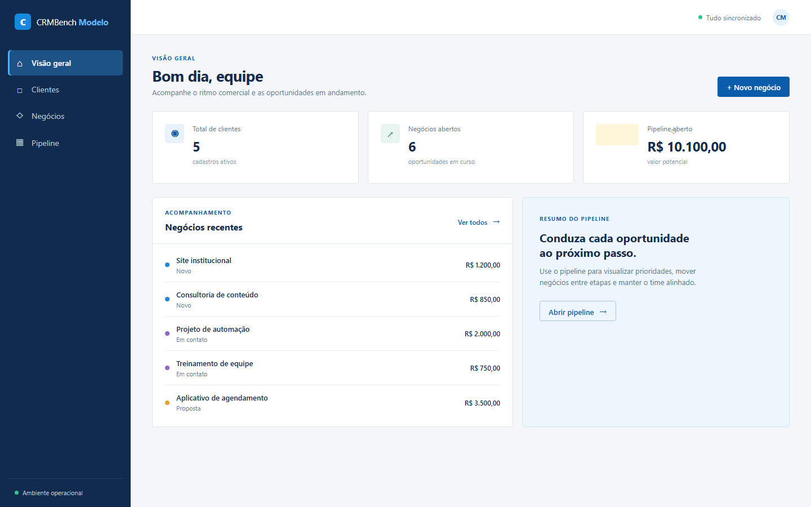
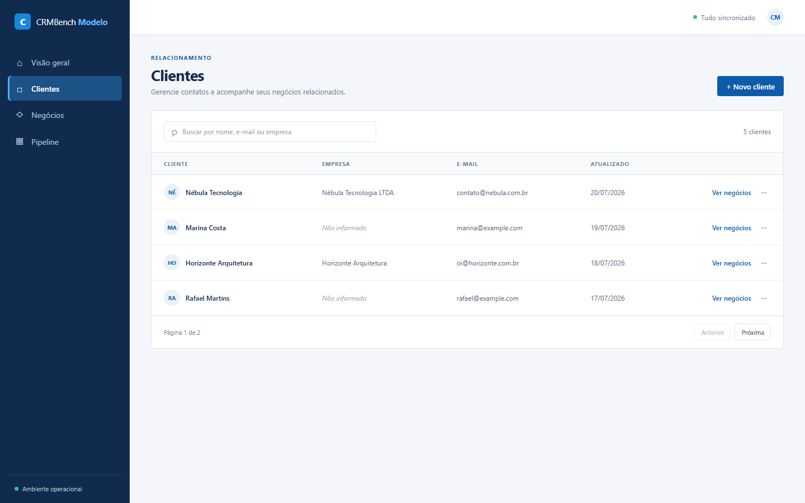
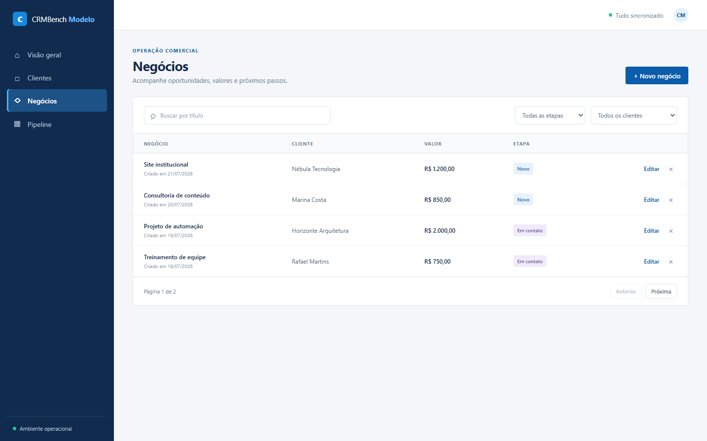
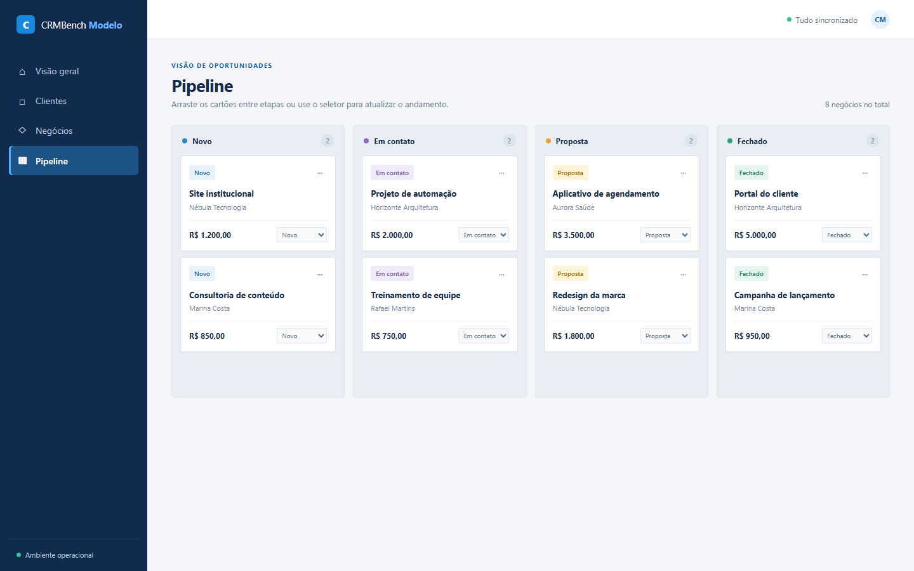

# Relatório da avaliação — gpt-5-6-luna__openrouter__2026-09-10

**Nota:** 95/100

**Resultado:** 21 passaram, 1 falhou e 0 não puderam ser executados.

## Execução

| Campo | Valor |
|---|---:|
| Modelo | `openai/gpt-5.6-luna` |
| Provider | OpenRouter |
| Harness | OpenCode 1.18.30 |
| Raciocínio | `high` |
| Custo da criação | US$ 0,06 |
| Tempo oficial | 5m40s |
| Turnos | 28 |
| Chamadas de ferramentas | 42 |

A execução válida foi concluída de forma autônoma, com uma única mensagem do usuário e sem prompt de correção. O tempo oficial corresponde à sessão completa, sem pausa externa descontada.

## Screenshots

### Dashboard

### Clientes

### Negócios

### Pipeline

## Resumo em linguagem simples

### O que funcionou

- **Instalação e banco:** as dependências foram instaladas normalmente e o banco foi recriado duas vezes com o seed correto.
- **Build e inicialização:** frontend e servidor compilaram e a aplicação serviu API e interface na mesma origem.
- **API de clientes:** criação, listagem, busca, paginação, edição, exclusão e integridade dos relacionamentos funcionaram.
- **Negócios:** CRUD, busca, filtros, paginação, validações e relacionamento com clientes funcionaram na API e na interface.
- **Indicadores:** os valores acompanharam exatamente os dados persistidos.
- **Pipeline:** as quatro etapas e todos os cartões apareceram; a mudança pelo seletor e pelo arrastar e soltar persistiu após reiniciar o servidor.
- **Interface:** feedbacks de erro, sucesso, confirmação e estado vazio funcionaram, sem overflow nas duas larguras testadas.
- **Qualidade:** o nome obrigatório foi usado, quatro testes automatizados passaram e o README documentou os comandos exigidos.

### O que não funcionou

O fluxo visual de clientes perdeu os 5 pontos disponíveis porque a interface não oferece uma ação para excluir clientes. A criação, a edição, a busca, a paginação e o acesso aos negócios relacionados funcionaram; a exclusão também funciona pela API. Porém, como o contrato exige o CRUD completo pela interface e essa verificação é indivisível, `ui.client_flow` recebeu 0/5.

## Auditoria contra falsos negativos

A primeira passagem revelou incompatibilidades genéricas do avaliador com implementações funcionalmente válidas. Sem alterar o projeto participante, o avaliador foi ajustado para aceitar campos de busca acessíveis sem depender de um único seletor, confirmações nativas do navegador, textos equivalentes de estado vazio e a omissão correta de campos opcionais. A contagem de testes também deixou de incluir artefatos compilados.

Cada ajuste foi validado novamente contra a aplicação de referência, que permaneceu em 100/100. Depois dessa auditoria, a única falha restante foi reproduzida e confirmada visualmente: não existe ação de exclusão de cliente na interface.

## Resultado por verificação

| Verificação | Resultado | Pontos | Evidência |
|---|---:|---:|---|
| setup.install | PASS | 2/2 | `npm install` concluiu em 11223 ms com a stack obrigatória. |
| setup.database | PASS | 3/3 | `db:setup` recriou duas vezes o banco isolado indicado por `DB_PATH`. |
| setup.build | PASS | 4/4 | O build de produção concluiu em 4520 ms. |
| setup.start | PASS | 5/5 | `npm start` serviu a API e a interface na mesma origem. |
| clients.create | PASS | 5/5 | Cliente 6 foi criado com campos normalizados e timestamps válidos. |
| clients.read | PASS | 4/4 | Listagem, busca case-insensitive e páginas de clientes refletiram o banco. |
| clients.update | PASS | 4/4 | A edição parcial mudou o nome, preservou o e-mail e atualizou o timestamp. |
| clients.delete | PASS | 5/5 | Cliente sem vínculo foi excluído; cliente com negócio recebeu 409 sem cascata. |
| deals.create | PASS | 6/6 | Negócio 9 foi criado e ligado ao cliente 6. |
| deals.read | PASS | 4/4 | Listagem, busca, filtros combinados e paginação de negócios refletiram o banco. |
| deals.update | PASS | 5/5 | A edição parcial persistiu a etapa e preservou os demais campos. |
| deals.delete | PASS | 4/4 | O negócio solicitado foi excluído sem remover clientes ou outros dados. |
| deals.validation | PASS | 4/4 | Título, valor, etapa e relacionamento inválidos foram recusados sem gravação parcial. |
| metrics.accuracy | PASS | 8/8 | Os indicadores conferiram antes e depois de criar, fechar e excluir um negócio. |
| pipeline.render | PASS | 6/6 | As quatro etapas, na ordem correta, exibiram todos os negócios persistidos. |
| pipeline.persistence | PASS | 6/6 | A etapa mudou pela interface e permaneceu no SQLite após reiniciar o servidor. |
| pipeline.drag_drop | PASS | 5/5 | O cartão foi arrastado e permaneceu na nova coluna após reiniciar o servidor. |
| ui.client_flow | **FAIL** | **0/5** | A interface não apresentou botão ou link para excluir/remover o cliente criado. |
| ui.deal_flow | PASS | 5/5 | Paginação, busca, filtros combinados e CRUD de negócios funcionaram pela interface. |
| ui.feedback | PASS | 4/4 | Erro, sucesso, confirmação e estado vazio ficaram visíveis, sem overflow nas duas viewports. |
| ui.app_name | PASS | 1/1 | O título do navegador e a marca visível usam CRMBench Modelo. |
| quality.tests_docs | PASS | 5/5 | 4 testes passaram e o README documentou os cinco comandos obrigatórios. |

_Relatório produzido a partir do avaliador determinístico. A sessão bruta permaneceu privada._
